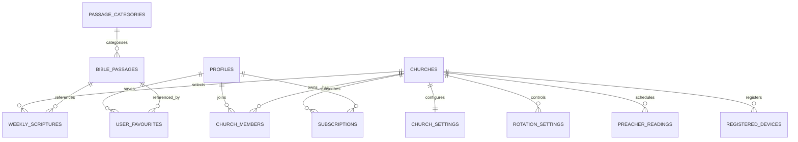

# REVOLVING BIBLE – DATABASE DESIGN

**Document ID:** RB-DD-001  
**Version:** 1.0  
**Project Owner / Founder:** Craig Francis  
**Document Owner:** Revolving Bible Project  
**Database Platform:** Supabase PostgreSQL  
**Status:** Initial Database Design  
**Related Documents:**
- PRODUCT_SPECIFICATION.md
- SYSTEM_ARCHITECTURE.md

---

# 1. Introduction

This document describes the database structure for the Revolving Bible application.

It records the existing database implementation and establishes the proposed database design for the commercial application.

The database must support:

- Bible passage storage.
- Automatic Scripture rotation.
- Preacher-controlled readings.
- Individual user accounts.
- Multiple church accounts.
- Church-specific Scripture management.
- Registered devices.
- User favourites.
- Scripture of the Week.
- Subscription management.
- Secure administration.

The database must be expandable without unnecessarily disrupting existing functionality.

# 2. Database Environment

The current prototype uses Supabase, which provides a PostgreSQL database and associated backend services.

**Existing Supabase project URL:**

`https://tthgeaiokpltmfxxmibb.supabase.co`

The project URL is public application configuration. Database secret keys and service-role credentials must never be included in this document or publicly accessible frontend code.

# 3. Existing Database Implementation

The prototype currently contains three tables:

1. bible_passages
2. rotation_settings
3. preacher_readings

Row Level Security (RLS) has been enabled on all three tables.

Public read policies have been established, and public write policies have not been created.

## 3.1 Table: bible_passages

**Purpose:** Stores the Bible passages available for automatic rotation.

| Column | Data Type | Configuration |
|---|---|---|
| id | BIGINT | Identity, Primary Key |
| book | TEXT | NOT NULL |
| chapter | INTEGER | NOT NULL |
| verse_start | INTEGER | NOT NULL |
| verse_end | INTEGER | Nullable |
| passage_text | TEXT | NOT NULL |
| translation | TEXT | NOT NULL, Default KJV |
| active | BOOLEAN | NOT NULL, Default TRUE |
| created_at | TIMESTAMPTZ | NOT NULL, Default NOW() |

**Current functionality:**

- Stores individual Bible passages.
- Identifies the Bible book and chapter.
- Supports single verses and verse ranges.
- Identifies the translation.
- Allows passages to be marked active or inactive.
- Provides the active passages to the revolving Scripture display.

**Current data:** 30 active passages.

**Security policy:**

- RLS enabled.
- SELECT access granted to anon and authenticated roles for active passages.
- Public write access not granted.

## 3.2 Table: rotation_settings

**Purpose:** Stores the configuration controlling automatic Scripture rotation.

| Column | Data Type | Configuration |
|---|---|---|
| id | INTEGER | Primary Key, Default 1, CHECK id = 1 |
| rotation_interval_seconds | INTEGER | NOT NULL, Default 60 |
| rotation_start_at | TIMESTAMPTZ | NOT NULL, Default NOW() |
| updated_at | TIMESTAMPTZ | NOT NULL, Default NOW() |

**Current functionality:**

- Stores the rotation interval.
- Stores the common rotation start time.
- Provides timing information to connected displays.
- Supports the server-time synchronisation implementation.

**Current configuration:** 60-second rotation interval.

**Security policy:**

- RLS enabled.
- SELECT access granted to anon and authenticated roles.
- Public write access not granted.

## 3.3 Table: preacher_readings

**Purpose:** Stores the Scripture selected for a preacher or church service.

| Column | Data Type | Configuration |
|---|---|---|
| id | BIGINT | Identity, Primary Key |
| book | TEXT | Nullable |
| chapter | INTEGER | Nullable |
| verse_start | INTEGER | Nullable |
| verse_end | INTEGER | Nullable |
| passage_text | TEXT | Nullable |
| translation | TEXT | Nullable |
| service_date | DATE | Nullable |
| service_type | TEXT | Nullable |
| created_at | TIMESTAMPTZ | Default NOW() |

**Current intended functionality:**

- Stores selected preacher readings.
- Identifies the service date.
- Allows a service type to be recorded.
- Keeps preacher readings separate from the automatic rotation collection.

**Security policy:**

- RLS enabled.
- SELECT access granted to anon and authenticated roles.
- Public write access not granted.

The current table is a prototype structure. Its fields, constraints and security policies will be reviewed during the commercial database redesign.

# 4. Server-Time Function

The prototype includes a PostgreSQL function:

**Function name:** get_server_time()

**Purpose:** Returns the database server's current timestamp to support synchronised Scripture rotation.

Current implementation:

```sql
CREATE OR REPLACE FUNCTION public.get_server_time()
RETURNS timestamptz
LANGUAGE sql
VOLATILE
AS $$
    SELECT clock_timestamp();
$$;

GRANT EXECUTE ON FUNCTION public.get_server_time()
TO anon, authenticated;
```

The frontend calls this function through Supabase RPC.

The client estimates its time difference from the server and uses that offset when calculating the active Scripture passage.

This function is part of the existing prototype and must be preserved or deliberately replaced during future development.

# 5. Existing Security Configuration

RLS is enabled on all three existing database tables.

Current access arrangement:

| Table | Anonymous Read | Authenticated Read | Public Write |
|---|---|---|---|
| bible_passages | Active passages | Active passages | Not granted |
| rotation_settings | Yes | Yes | Not granted |
| preacher_readings | Yes | Yes | Not granted |

Important security considerations:

- Existing public read policies are prototype policies.
- Commercial church data must not use unrestricted public read access.
- Church-specific information must be protected by church membership and role permissions.
- Administrative operations must be performed through authorised access.
- All future RLS policies must be documented and tested.

# 6. Proposed Commercial Database Architecture

The commercial version will require additional database tables.

The design must support individual users, multiple churches, church administrators, connected devices and subscriptions.

The following tables are proposed:

| Table | Purpose | Status |
|---|---|---|
| profiles | Individual user profiles | Planned |
| churches | Registered churches | Planned |
| church_members | Church membership and roles | Planned |
| church_settings | Church configuration | Planned |
| bible_passages | Central Scripture library | Existing, requires expansion |
| passage_categories | Scripture classifications | Planned |
| rotation_settings | Rotation configuration | Existing, requires redesign |
| preacher_readings | Preacher readings | Existing, requires redesign |
| registered_devices | Connected displays and devices | Planned |
| weekly_scriptures | Scripture of the Week | Planned |
| user_favourites | Saved individual passages | Planned |
| subscriptions | Subscription information | Planned |
| audit_logs | Administrative activity records | Planned |

# 7. Proposed Commercial Table Designs

## 7.1 profiles

**Purpose:** Stores additional information about registered application users.

Proposed fields:

- id – UUID, Primary Key, linked to Supabase Auth.
- display_name – TEXT.
- email – TEXT, where appropriate.
- created_at – TIMESTAMPTZ.
- updated_at – TIMESTAMPTZ.

Authentication credentials must remain managed by Supabase Auth.

## 7.2 churches

**Purpose:** Stores registered church information.

Proposed fields:

- id – UUID, Primary Key.
- church_name – TEXT, NOT NULL.
- description – TEXT.
- contact_email – TEXT.
- country – TEXT.
- timezone – TEXT.
- subscription_status – TEXT.
- created_at – TIMESTAMPTZ.
- updated_at – TIMESTAMPTZ.

Each registered church must have a unique identifier.

## 7.3 church_members

**Purpose:** Connects individual user accounts to churches.

Proposed fields:

- id – UUID, Primary Key.
- church_id – UUID, Foreign Key to churches.
- user_id – UUID, Foreign Key to profiles.
- role – TEXT.
- membership_status – TEXT.
- created_at – TIMESTAMPTZ.

Proposed roles:

- Church Owner.
- Church Administrator.
- Church Editor.
- Church Member.

A user may belong to more than one church where authorised.

## 7.4 church_settings

**Purpose:** Stores individual church configuration.

Proposed fields:

- id – UUID, Primary Key.
- church_id – UUID, Foreign Key to churches.
- rotation_interval_seconds – INTEGER.
- default_translation – TEXT.
- display_theme – TEXT.
- timezone – TEXT.
- updated_at – TIMESTAMPTZ.

Each church should have its own configuration.

## 7.5 passage_categories

**Purpose:** Organises Bible passages into meaningful categories.

Proposed fields:

- id – UUID, Primary Key.
- category_name – TEXT.
- description – TEXT.
- created_at – TIMESTAMPTZ.

Examples:

- Faith and Trust.
- Love and Relationships.
- Hope and Encouragement.
- Wisdom and Understanding.
- Prayer and Spiritual Growth.
- Forgiveness and Mercy.
- Family and Christian Living.

## 7.6 Commercial bible_passages

The existing table will be reviewed and expanded.

Proposed additional fields include:

- category_id – UUID, Foreign Key to passage_categories.
- edition – TEXT.
- source_reference – TEXT.
- approval_status – TEXT.

The existing passage information should be retained where practical.

The commercial library should initially target at least 365 passages, with the capacity to expand beyond 1,000.

## 7.7 Commercial rotation_settings

The current single-record rotation design will be expanded to support multiple churches.

Proposed fields:

- id – UUID, Primary Key.
- church_id – UUID, Foreign Key to churches.
- rotation_interval_seconds – INTEGER.
- rotation_start_at – TIMESTAMPTZ.
- rotation_status – BOOLEAN.
- updated_at – TIMESTAMPTZ.

This will allow each church to maintain its own rotation schedule.

## 7.8 Commercial preacher_readings

The commercial table will be expanded to associate readings with churches and services.

Proposed additional fields:

- church_id – UUID, Foreign Key to churches.
- selected_by – UUID, Foreign Key to profiles.
- service_id – UUID, where applicable.
- status – TEXT.
- updated_at – TIMESTAMPTZ.

The preacher reading display must remain independent of the automatic rotation process.

## 7.9 registered_devices

**Purpose:** Keeps track of devices connected to church accounts.

Proposed fields:

- id – UUID, Primary Key.
- church_id – UUID, Foreign Key to churches.
- device_name – TEXT.
- device_type – TEXT.
- device_status – TEXT.
- last_seen_at – TIMESTAMPTZ.
- created_at – TIMESTAMPTZ.

Device registration must be controlled by authorised church administrators.

## 7.10 weekly_scriptures

**Purpose:** Stores each church's selected Scripture of the Week.

Proposed fields:

- id – UUID, Primary Key.
- church_id – UUID, Foreign Key to churches.
- passage_id – BIGINT, Foreign Key to bible_passages.
- start_date – DATE.
- end_date – DATE.
- selected_by – UUID, Foreign Key to profiles.
- created_at – TIMESTAMPTZ.

## 7.11 user_favourites

**Purpose:** Stores passages saved by individual users.

Proposed fields:

- id – UUID, Primary Key.
- user_id – UUID, Foreign Key to profiles.
- passage_id – BIGINT, Foreign Key to bible_passages.
- created_at – TIMESTAMPTZ.

Users must only be able to access and manage their own favourites.

## 7.12 subscriptions

**Purpose:** Manages subscription information for individual and church plans.

Proposed fields:

- id – UUID, Primary Key.
- user_id – UUID, nullable where applicable.
- church_id – UUID, nullable where applicable.
- plan_name – TEXT.
- subscription_status – TEXT.
- billing_provider – TEXT.
- external_subscription_id – TEXT.
- start_date – TIMESTAMPTZ.
- renewal_date – TIMESTAMPTZ.
- created_at – TIMESTAMPTZ.

Actual payment information should be handled by an appropriate payment provider. Sensitive card details must not be stored directly in the Revolving Bible database.

## 7.13 audit_logs

**Purpose:** Records important administrative and security-related activities.

Proposed fields:

- id – UUID, Primary Key.
- user_id – UUID.
- church_id – UUID, nullable.
- action – TEXT.
- entity_type – TEXT.
- entity_id – TEXT.
- created_at – TIMESTAMPTZ.

Audit records should be protected against unauthorised modification.

# 8. Proposed Database Relationships

The commercial database should use the following general relationships:



This is a proposed logical relationship diagram. The final implementation must define all foreign keys, uniqueness rules and deletion behaviour.

# 9. Database Security Requirements

The commercial database must enforce Row Level Security.

Required principles:

1. Individual users can only manage their own personal information and favourites.
2. Church members can only access information they are authorised to view.
3. Church administrators can only administer their assigned churches.
4. Church editors must have limited permissions appropriate to their roles.
5. One church must not access another church's private information.
6. Public QR access must be restricted to specifically approved public Scripture content.
7. Administrative database operations must require appropriate authorisation.
8. Subscription information must be protected.
9. Audit records must not be publicly accessible.

All policies must be tested using different user roles before commercial deployment.

# 10. Database Migration Strategy

The existing prototype database must not be discarded or unnecessarily recreated.

Commercial database changes must be introduced through controlled migrations.

Each migration should:

- Have a unique version or timestamp.
- Document its purpose.
- Record affected tables and functions.
- Preserve existing data where possible.
- Include necessary security policy changes.
- Be tested before production deployment.
- Include rollback or recovery instructions where practical.

Migration scripts will be stored in:

`database/migrations/`

# 11. Database Backup and Recovery

The project must maintain independent database backups.

Backup requirements:

- Database schema backup.
- Database content backup.
- Migration script preservation.
- Documented restoration procedures.
- Periodic recovery testing.

GitHub source-code history does not replace a database backup.

# 12. Implementation Status

| Database Component | Status |
|---|---|
| bible_passages | Implemented |
| rotation_settings | Implemented |
| preacher_readings | Implemented |
| get_server_time() | Implemented |
| RLS on existing tables | Implemented |
| Existing public read policies | Implemented |
| Commercial profiles | Planned |
| Commercial churches | Planned |
| Church memberships | Planned |
| Church settings | Planned |
| Passage categories | Planned |
| Registered devices | Planned |
| Scripture of the Week | Planned |
| User favourites | Planned |
| Subscriptions | Planned |
| Audit logs | Planned |

# 13. Database Design Principles

The following principles will guide future database development:

- Maintain clear and consistent naming conventions.
- Use appropriate data types.
- Establish primary and foreign keys.
- Avoid unnecessary duplication of information.
- Apply database constraints.
- Index frequently queried fields where justified.
- Protect church and user information.
- Document all significant changes.
- Preserve existing working functionality.
- Design for future scalability.

# 14. Conclusion

This document establishes the initial database reference for Revolving Bible.

It records the three existing prototype tables and the server-time function while defining the proposed commercial database architecture.

All future database development must be documented, tested and version-controlled.

The database must remain secure, scalable, maintainable and recoverable throughout the life of the application.

---

**Project Owner / Founder:** Craig Francis  
**Document Owner:** Revolving Bible Project  
**Document ID:** RB-DD-001  
**Version:** 1.0

**End of Database Design Document**
