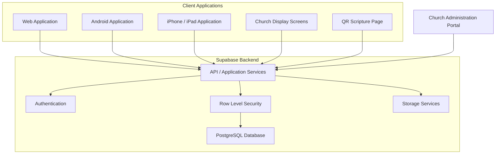

# REVOLVING BIBLE – SYSTEM ARCHITECTURE

**Document ID:** RB-SA-001  
**Version:** 1.0  
**Project Owner / Founder:** Craig Francis  
**Document Owner:** Revolving Bible Project  
**Status:** Initial Architecture Design  
**Related Document:** PRODUCT_SPECIFICATION.md

---

# 1. Introduction

This document defines the proposed technical architecture for the Revolving Bible application.

It describes the major software components, their responsibilities, communication methods, security requirements and relationships.

The architecture will support both individual users and churches through a shared, expandable platform.

The system must be capable of supporting Android, iOS, tablets, web browsers and church presentation displays.

This document distinguishes between the existing prototype and the proposed commercial architecture.

# 2. Architectural Objectives

The architecture must:

1. Support multiple platforms using a shared application foundation.
2. Provide reliable Scripture rotation across connected devices.
3. Maintain a centralised Scripture database.
4. Support individual and church accounts.
5. Separate information belonging to different churches.
6. Provide secure administrative functions.
7. Support QR-based Scripture access.
8. Allow future expansion without requiring a complete system rebuild.
9. Provide documented backup and recovery procedures.
10. Remain maintainable by other qualified developers.

# 3. High-Level System Architecture

The commercial application will use a client-server architecture.

The client applications will communicate with the Supabase backend through authenticated API requests and approved database access policies.

The backend will manage authentication, Scripture data, church information, rotation settings and other application information.

## 3.1 Architecture Overview



The diagram represents the proposed commercial architecture, not a claim that every component is already implemented.

# 4. Client Applications

## 4.1 Web Application

The web application will provide browser-based access.

Its responsibilities include:

- Displaying revolving Scripture.
- Providing QR-based Scripture access.
- Displaying preacher readings.
- Supporting church administration.
- Providing access to individual Scripture features.

The existing GitHub Pages website will remain the prototype while the commercial frontend is developed.

## 4.2 Android Application

The Android application will provide:

- Individual Scripture access.
- Automatic Scripture rotation.
- Favourite passages.
- Scripture sharing.
- Church display functionality.
- Connected device support.

## 4.3 iOS Application

The iOS application will provide equivalent core functionality for iPhones and iPads.

The application will use the same backend and shared application architecture wherever practical.

## 4.4 Church Presentation Displays

Church displays may include:

- Smart televisions.
- Tablets.
- Desktop computers.
- Projectors connected to computers.

Displays should support a clear, readable full-screen Scripture presentation.

# 5. Backend Architecture

Supabase will provide the primary backend infrastructure.

The backend will consist of the following services:

| Component | Responsibility |
|---|---|
| Supabase Auth | User authentication |
| PostgreSQL | Central data storage |
| API services | Communication with clients |
| Row Level Security | Data access protection |
| Storage | Future media and application assets |
| Database functions | Server-side operations |

Backend operations must be designed to prevent unauthorised access and modifications.

# 6. Database Architecture

PostgreSQL will serve as the central database.

The commercial database will support the following main entities:

- Individual user profiles.
- Churches.
- Church memberships.
- Church settings.
- Bible passages.
- Passage categories.
- Rotation settings.
- Preacher readings.
- Registered devices.
- Scripture of the Week.
- User favourites.
- Subscriptions.
- Audit logs.

The detailed table structures, relationships, constraints and security policies will be documented in DATABASE_DESIGN.md.

# 7. Scripture Rotation Architecture

Scripture rotation is the principal feature of Revolving Bible.

The rotation system must ensure that connected devices display the same passage at approximately the same time.

## 7.1 Rotation Process

1. The client retrieves the active Scripture library.
2. The client retrieves the church's rotation configuration.
3. The backend provides the common rotation start time and interval.
4. The client retrieves server time.
5. The client calculates the currently active passage.
6. The display updates automatically when the next rotation period begins.
7. Connected clients periodically resynchronise with the backend.

## 7.2 Rotation Calculation

The proposed calculation is:

```text
Elapsed Time = Current Server Time - Rotation Start Time

Rotation Number = Floor(Elapsed Time / Rotation Interval)

Current Passage Index = Rotation Number MOD Active Passage Count
```

The implementation must also handle inactive passages, empty libraries, changes to the active passage collection and changes to rotation settings.

## 7.3 Synchronisation

The application must not depend entirely on the local device clock.

Server time will provide the common timing reference.

Clients should periodically correct their estimated server-time offset.

The synchronisation process must be tested on devices with different local clock settings and network conditions.

# 8. Preacher Reading Architecture

Preacher readings must operate independently from automatic Scripture rotation.

The church administrator or authorised editor will select a passage for a particular service.

The backend will store the selected reading.

The preacher display will retrieve and display the selected passage without interrupting the revolving Scripture display.

The system should support changes to the selected reading during a service.

# 9. QR Scripture Architecture

Each church should have a reusable QR code or QR destination.

When a member scans the code:

1. The mobile device opens the church's Scripture page.
2. The page identifies the relevant church or shared Scripture destination.
3. The backend retrieves the currently active passage.
4. The passage is displayed in a simple mobile-friendly layout.

The QR code should not need to change every time the revolving Scripture changes.

Unauthenticated visitors should only receive access to information intentionally made public by the church.

# 10. Church Administration Architecture

The administration portal will allow authorised users to manage church-specific settings.

Functions will include:

- Church profile management.
- User and role management.
- Scripture library management.
- Rotation settings.
- Preacher readings.
- Scripture of the Week.
- Registered device management.
- Subscription information.

Administrative permissions must be enforced through backend security policies.

# 11. Multi-Church Architecture

The commercial platform must support multiple churches.

Each church will have a unique identifier.

Church-specific records will be associated with the relevant church identifier.

The database must enforce separation between churches so that one church cannot access or modify another church's private settings or records.

The design should support an individual who belongs to more than one church, where permitted.

# 12. Security Architecture

Security must be incorporated throughout the application.

Requirements include:

- Secure authentication.
- Role-based access control.
- PostgreSQL Row Level Security.
- Protected administrative operations.
- Secure session handling.
- Appropriate API access restrictions.
- Protection of secret credentials.
- Audit logging for sensitive administrative actions.

The Supabase service-role key must never be placed in publicly accessible client-side code.

Public access must be limited to explicitly approved information and operations.

# 13. Offline and Recovery Architecture

The application should maintain a useful display during temporary connectivity interruptions.

Proposed behaviour:

1. Cache recently retrieved Scripture passages.
2. Continue displaying the last successfully retrieved passage.
3. Indicate loss of connectivity where appropriate.
4. Retry backend communication when connectivity returns.
5. Resynchronise rotation timing.
6. Retrieve any updated settings or passages.

The system must not silently treat an outdated cached passage as the latest server-confirmed passage.

# 14. Proposed Commercial Technology Stack

| Layer | Proposed Technology |
|---|---|
| Frontend | Ionic |
| UI framework | React |
| Mobile deployment | Capacitor |
| Backend | Supabase |
| Database | PostgreSQL |
| Authentication | Supabase Auth |
| Source control | GitHub |
| Initial web hosting | GitHub Pages |
| Future hosting | To be evaluated |

Technology choices may be revised when justified by performance, security, cost or maintainability requirements.

Any major architecture change must be recorded in the project decision log.

# 15. Source Code Architecture

The proposed commercial source-code structure will be organised into clear functional areas.

```text
src/
│
├── components/
├── pages/
├── layouts/
├── services/
├── hooks/
├── contexts/
├── assets/
├── config/
└── utilities/
```

Responsibilities:

- components: reusable interface elements.
- pages: application screens.
- layouts: shared page structures.
- services: backend communication and business logic.
- hooks: reusable React functionality.
- contexts: shared application state.
- assets: images, icons and other resources.
- config: application configuration.
- utilities: shared helper functions.

# 16. Backup and Disaster Recovery

The system must maintain independent backups of:

- Application source code.
- Database structure.
- Database content.
- Configuration documentation.
- Deployment instructions.

GitHub will preserve source-code history.

Database backups must be maintained independently of the source repository.

Recovery procedures must be documented and tested.

# 17. Architecture Testing Requirements

The following areas must be tested:

1. Communication between client applications and Supabase.
2. Scripture retrieval.
3. Scripture rotation accuracy.
4. Synchronisation between multiple devices.
5. Preacher reading independence.
6. QR access.
7. Multi-church data separation.
8. User authentication.
9. Role-based permissions.
10. Offline recovery.
11. Backup restoration.
12. Mobile and tablet compatibility.

# 18. Architecture Development Status

The following status distinguishes current prototype functionality from proposed commercial capabilities.

| Component | Current Status |
|---|---|
| GitHub-hosted website | Implemented |
| Supabase database | Implemented |
| 30 active Scripture passages | Implemented |
| Automatic Scripture rotation | Implemented |
| Initial server-time synchronisation | Implemented |
| QR congregation page | Planned |
| Preacher reading display | Planned |
| Church administration portal | Planned |
| Multi-church architecture | Planned |
| Android application | Planned |
| iOS application | Planned |
| Commercial subscription system | Planned |

Implementation status must be updated as development progresses.

# 19. Conclusion

This architecture establishes the technical foundation for the commercial Revolving Bible platform.

It is designed to support individual Scripture engagement, church presentation, synchronised devices and future commercial expansion.

The system must remain secure, maintainable, documented and recoverable throughout its development and operational life.

---

**Document Owner:** Revolving Bible Project  
**Project Owner / Founder:** Craig Francis  
**Document ID:** RB-SA-001  
**Version:** 1.0

**End of System Architecture Document**
